# ⚡ Odoo MCP Server — AI Assistant Integration for Odoo

**Odoo MCP** brings the power of **ChatGPT**, **Claude**, **Cursor**, **Grok**, **Windsurf**, and **Cline** directly into your Odoo ERP. It allows anyone — from business executives to sales managers and accountants — to chat with their business data in plain English, preview live dashboards inside chat, audit finances, and automate everyday workflows with **zero technical knowledge required**.

<p align="center">
  
  
  
  
  
  
  
</p>

<p align="center">
  <strong>Transform your AI into your most effective Odoo business assistant.</strong><br>
  No external servers, no complex Docker setups, no database coding. Install natively in Odoo, generate a token, and start chatting.
</p>

<p align="center">
  <a href="#-quickstart-guide">Quickstart</a> •
  <a href="#-client-configuration">Connect Your AI</a> •
  <a href="#-business-capabilities-overview">What It Can Do</a> •
  <a href="#-real-world-ai-demonstrations-in-action--live-unedited-proof">Live Demos &amp; Examples</a> •
  <a href="#-zero-trust-security--peace-of-mind">Security</a> •
  <a href="#-faq--frequently-asked-questions">FAQ</a>
</p>

---

## 💡 Why Odoo MCP?

Connecting AI models to Odoo used to require complex custom scripts, external Docker containers, or risky admin access. **Odoo MCP Server runs 100% natively inside your Odoo system:**

| What You Need | Odoo MCP Server | Traditional Scripts & Third-Party Wrappers |
| :--- | :--- | :--- |
| **Setup Simplicity** | ⚡ **One-click module install** — no extra servers or containers | Complex Docker setups, external node servers, pip dependencies |
| **Data Security** | 🔒 **Strict user security** — AI only sees what your user can see | Often uses shared admin passwords, risking full data exposure |
| **Dashboards** | 📊 **Interactive in-chat preview + 1-click Odoo creation** | Static text dumps; no visual preview or native spreadsheets |
| **Speed & Efficiency** | 🚀 **Direct in-process execution** (<10ms response time) | Slow multi-step network connections |
| **Token Economy** | 📉 **Smart compression** (saves ~70% AI costs by removing noise) | Sends raw database clutter with 150+ unused fields |
| **Safety Control** | 🛡️ **Read-only mode, rate limits & bulk-action protection** | No guardrails against accidental mass data edits |

---

## 🎥 Real-World AI Demonstrations in Action — Live Unedited Proof

Watch complete end-to-end sessions recorded live in **Claude Code**—from natural language business prompts to multi-model data audits, supply chain replenishment analysis, and instant spreadsheet dashboard generation:

<details open>
<summary><b>🔗 1. Multi-Model Intelligence (Cross-Module Analysis)</b></summary>
<br>

Query and correlate live Contacts (`res.partner`), CRM Deals (`crm.lead`), and Sales Quotations (`sale.order`) in a single conversational turn.

> 🎬 **Live Claude Code Recording**:  
> [▶️ Watch Video (ex_1.mp4)](abi_odoo_mcp/static/description/videos/ex_1.mp4)

<video autoplay loop muted playsinline width="100%" preload="metadata">
  <source src="abi_odoo_mcp/static/description/videos/ex_1.mp4" type="video/mp4">
  Your browser does not support the video tag.
</video>

<br>

<details>
<summary><b>💬 View Example Prompt (Click to expand)</b></summary>
<br>

```text
Search for the 5 most recently created contacts and show their names, email addresses, phone numbers, and company names. List the 5 most recently updated CRM opportunities, including their opportunity name, customer, sales team or salesperson, expected revenue, and stage. Find quotations in draft or sent status and show their reference, customer, total amount, and status. Explain which Odoo records are linked to each other and identify any missing information. Use live data from my Odoo instance. Do not create, modify, or delete anything. If a requested field is unavailable, tell me instead of guessing.
```
</details>

<details>
<summary><b>📋 View Live AI Output / Response (Click to expand)</b></summary>
<br>

All data below was read live from your Odoo instance. I only ran read queries, so nothing was created, changed or deleted.

#### 5 most recently created contacts (`res.partner`)

| Name | Email | Phone | Company |
|---|---|---|---|
| My Company (Chicago) | chicago@yourcompany.com | +1 312 349 3030 | None (it is itself a company record) |
| Jeff Lawson | jeff.lawson52@example.com | (461)-417-6587 | My Company (Chicago) |
| Doris Cole | doris.cole31@example.com | Not set | Not set |
| Rachel Perry | jod@odoo.com | Not set | Not set |
| Keith Byrd | keith.byrd52@example.com | Not set | Not set |

- **Company:** the `company_name` field is empty for every record. I took the company from the parent contact (`parent_id`), which only Jeff Lawson has.
- **Tied timestamps:** the last three share the exact same creation timestamp as many other seeded contacts. Which three appear after the first two is therefore arbitrary, not a true "most recent".

#### 5 most recently updated opportunities (`crm.lead`)

| Opportunity | Customer | Salesperson / Team | Expected revenue | Stage |
|---|---|---|---|---|
| Need 20 Desks | Not set | Mitchell Admin / Sales | 60,000 | Proposition |
| Modern Open Space | E-light Industry (text only) | Mitchell Admin / Sales | 4,500 | Proposition |
| Balmer Inc: Potential Distributor | BalmerInc S.A. (text only) | Marc Demo / Pre-Sales | 1,000 | Qualified |
| Quote for 600 Chairs | Not set | Mitchell Admin / Sales | 22,500 | Qualified |
| Quote for 12 Tables | Rediff Mail (text only) | Mitchell Admin / Sales | 40,000 | New |

- **Customer:** none of these has a linked customer record (`partner_id` is empty). Where a name appears, it is only the free-text `partner_name`.
- **Currency:** I didn't query the opportunity currency, so the revenue figures have no currency attached.
- **Tied timestamps:** all five were last updated at the same moment, so this "top 5" is also arbitrary.

#### Quotations in draft or sent status (`sale.order`): 13 found

| Reference | Customer | Total (USD) | Status |
|---|---|---|---|
| S00046 | Azure Interior, Brandon Freeman | 1,264.00 | Sent |
| S00045 | Doris Cole | 1,680.00 | Draft |
| S00047 | Eli Lambert | 1,320.00 | Draft |
| S00048 | Acme Corporation | 11,250.00 | Draft |
| S00042 | Lumber Inc | 6,000.00 | Sent |
| S00043 | Gemini Furniture | 2,940.00 | Sent |
| S00041 | Azure Interior | 10,794.00 | Draft |
| S00044 | Abigail Peterson | 3,200.00 | Draft |
| S00005 | Acme Corporation | 405.00 | Draft |
| S00003 | Ready Mat | 377.50 | Draft |
| S00002 | Ready Mat | 2,947.50 | Draft |
| S00001 | Acme Corporation | 1,740.00 | Draft |
| S00019 | YourCompany, Joel Willis | 1,740.00 | Sent |

*Breakdown: 4 sent and 9 draft.*

#### How the records are linked

- **Contact to contact:** `res.partner.parent_id` links a person to a company. Jeff Lawson belongs to My Company (Chicago), and "Azure Interior, Brandon Freeman" is a contact under Azure Interior.
- **Quotation to customer:** every `sale.order` points to a contact through `partner_id`. Doris Cole is both a recently created contact and the customer on S00045, so those two records are connected.
- **Quotation to salesperson and team:** `user_id` and `team_id` link to Mitchell Admin (Sales) or Marc Demo (Pre-Sales). Opportunities use the same two fields.
- **Opportunity to quotation:** the link is `sale.order.opportunity_id`, which should point back to `crm.lead`.

#### Missing information & data quality findings

- **Opportunities have no customer record:** all five have an empty `partner_id`. Three carry only a text company name, and two have nothing at all.
- **Quotations are not linked to opportunities:** `opportunity_id` is empty on all 13. Despite names like "Quote for 600 Chairs", no quotation is tied to a CRM opportunity.
- **Contact details:** Doris Cole, Rachel Perry and Keith Byrd have no phone or company. Rachel Perry's email (`jod@odoo.com`) looks like a leftover demo value.
- **Team mismatch:** S00001 is owned by Marc Demo but sits in the Sales team, while his other quotations are in Pre-Sales. That may be intentional.
- **Ordering:** the "recent" results rely on tied timestamps, so if exact recency matters I can sort by record ID instead.

</details>

</details>

<details>
<summary><b>⚡ 2. Deep Operational Workflows (Supply Chain &amp; Replenishment)</b></summary>
<br>

Automate complex operational audits linking low stock, pending sales orders, supplier purchase orders, and vendor bills.

> 🎬 **Live Claude Code Recording**:  
> [▶️ Watch Video (ex_2.mp4)](abi_odoo_mcp/static/description/videos/ex_2.mp4)

<video autoplay loop muted playsinline width="100%" preload="metadata">
  <source src="abi_odoo_mcp/static/description/videos/ex_2.mp4" type="video/mp4">
  Your browser does not support the video tag.
</video>

<br>

<details>
<summary><b>💬 View Example Prompt (Click to expand)</b></summary>
<br>

```text
Use my connected Odoo instance to perform the following checks: Find products with low or zero available stock and show their names, internal references, on-hand quantities, and forecasted quantities. Identify confirmed sales orders containing those products and report the order number, customer, product, and quantity ordered. Check whether there are purchase orders for those products and report their suppliers, order status, and expected delivery dates when available. Identify customer invoices and vendor bills related to the relevant sales and purchase transactions, including their payment status and total amounts. Summarize the products that may need replenishment and explain the evidence behind each recommendation. Use actual Odoo records and clearly distinguish confirmed facts from recommendations. Do not confirm orders, validate receipts, create invoices, or modify inventory. If a relationship cannot be established from the available records, say so.
```
</details>

<details>
<summary><b>📋 View Live AI Output / Response (Click to expand)</b></summary>
<br>

### Low-stock review (read-only; nothing was modified)

All figures come from live Odoo records, queried 17 Oct 2026.

#### 1. Products with zero on-hand stock (confirmed)

22 sellable products have on-hand quantity 0. Only the 9 below have any open demand or supply. The other 13 have zero on-hand, forecast, incoming and outgoing: Desk Organizer, Desk Pad, LED Lamp, Letter Tray, Magnetic Board, Monitor Stand, Newspaper Rack, Small Shelf, Wall Shelf Unit, Acoustic Bloc Screens, Four Person Desk, Office Design Software, and Whiteboard.

| Product | Ref | On hand | Forecast | Incoming | Outgoing |
|---|---|---|---|---|---|
| Large Desk | E-COM09 | 0 | **-22** | 0 | 22 |
| Corner Desk Right Sit | E-COM06 | 0 | **-20** | 0 | 20 |
| Office Chair | FURN_7777 | 0 | 35 | 35 | 0 |
| Desk Stand with Screen | FURN_7888 | 0 | 125 | 125 | 0 |
| Flipover | FURN_9001 | 0 | 10 | 10 | 0 |
| Large Meeting Table | FURN_6741 | 0 | 0 | 0 | 0 |
| Office Lamp | FURN_8888 | 0 | 0 | 0 | 0 |
| Three-Seat Sofa | FURN_8999 | 0 | 0 | 0 | 0 |
| Drawer Black | FURN_8900 | 0 | 0 | 0 | 0 |

#### 2. Confirmed sales orders containing these products (confirmed)

All lines are in state "sale", with 0 delivered and 0 invoiced.

| Order | Customer | Product | Qty |
|---|---|---|---|
| S00037 | Eli Lambert | Large Desk | 10 |
| S00034 | Azure Interior | Large Desk | 8 |
| S00031 | Abigail Peterson | Large Desk | 4 |
| S00030 | Lumber Inc | Corner Desk Right Sit | 10 |
| S00024 | Gemini Furniture | Corner Desk Right Sit | 10 |
| S00007 | Gemini Furniture | Office Chair / Office Lamp / Three-Seat Sofa | 1 / 1 / 1 |
| S00004 | Gemini Furniture | Large Meeting Table / Office Chair / Office Lamp | 3 / 2 / 10 |

The Large Desk (10+8+4=22) and Corner Desk (10+10=20) totals match the "outgoing" figures. Each of those lines is linked to a delivery order (WH/OUT/00023, 00020, 00017, 00016 and 00011), all in "confirmed" (waiting for stock) status.

#### 3. Purchase orders for these products

**Confirmed POs (state "purchase"):**

| PO | Supplier | Product | Qty | Received | Expected |
|---|---|---|---|---|---|
| P00009 | Gemini Furniture | Large Desk | 20 | 0 | 10 Oct 2026 |
| P00009 | Gemini Furniture | Corner Desk Right Sit | 5 | 0 | 10 Oct 2026 |
| P00012 | Ready Mat | Flipover | 10 | 0 | 10 Oct 2026 |
| P00008 | Wood Corner | Flipover | 5 | 0 | 10 Oct 2026 |
| P00008 | Wood Corner | Drawer Black | 15 | 0 | 10 Oct 2026 |

**Unconfirmed POs (draft or sent):**
- **Office Chair:** P00001 Wood Corner 15, P00002 Gemini Furniture 5 and P00006 Wood Corner 3. Draft, planned 11–13 Oct.
- **Office Lamp:** P00002 Gemini Furniture 20, P00006 Wood Corner 9 and P00007 Ready Mat 15, all draft. P00004 Ready Mat 6 is "sent" (planned 15 Oct).
- **Flipover:** P00004 Ready Mat 5, "sent", planned 15 Oct.
- **Three-Seat Sofa:** P00006 Wood Corner 4, draft.
- **Desk Stand with Screen:** P00005 Acme Corporation 3, draft.

**Problems in the data:**
- The expected dates on all five confirmed POs are 10 Oct, which is already past. Nothing has been received, so these are overdue.
- Large Desk, Corner Desk and Drawer Black show 0 incoming even though P00009 and P00008 are confirmed. No receipt linked to those POs appears among the open stock moves I queried.
- Only P00012 (Flipover, 10) has a linked receipt, WH/IN/00006.
- The incoming receipts for Office Chair (35, WH/IN/00002) and Desk Stand with Screen (125, WH/IN/00003) have no purchase line link. I can't tie them to any PO.

#### 4. Invoices and bills

**No invoice or bill can be linked to the sales or purchase orders above.** The invoice lines have no sale-line or purchase-line links, and the invoice records show no origin.

**Product-level matches only:**
- Customer invoices and credit notes contain only Large Meeting Table and Three-Seat Sofa. The Large Desk, Corner Desk, Flipover and Drawer Black orders have no invoices at all, which matches their 0 invoiced quantities.
- The invoices are INV/2026/00001 to 00004 and the credit notes RINV/2026/00001 to 00005, all posted and not paid. They are for Azure Interior and Acme Corporation, which are not the customers on the SOs above.
- Office Chair appears on a vendor bill and a vendor credit note, both for 1 unit at 10 and from Azure Interior. Azure Interior is not the supplier on any PO listed above.
- No vendor bills exist for any of the open POs. All five confirmed POs show 0 invoiced.

#### 5. Replenishment assessment

**Confirmed facts:**
- Large Desk is short by 22 with 20 on confirmed order P00009, which is overdue and has no linked receipt.
- Corner Desk is short by 20 with only 5 on confirmed order P00009, which is overdue and has no linked receipt.
- Drawer Black has 15 on confirmed order P00008, which is overdue, and no demand.
- Flipover has an assigned receipt of 10, but the 5 on P00008 has no linked receipt.

**Recommendations:**

| Priority | Product | Evidence | Suggestion |
|---|---|---|---|
| **High** | Corner Desk Right Sit | Forecast -20, only 5 on order | Order about 15 more, and chase P00009 |
| **High** | Large Desk | Forecast -22, 20 on order, no receipt visible | Chase P00009 first. Even if it arrives, the forecast stays about 2 short, so consider ordering 2+ more |
| **Medium** | Office Chair, Office Lamp, Three-Seat Sofa, Large Meeting Table | Confirmed SO lines (S00004, S00007) with 0 delivered, but no outgoing move is counted and no confirmed PO covers them | Check whether these orders still need delivery before buying. If so, the draft POs are the likely supply |
| **Low** | Drawer Black, Flipover | Supply is already on order | Verify P00008 receipts |
| **Info** | 13 other zero-stock products | No demand or supply | No action needed |

*The Medium row is an inference. I can't tell from the records why those lines produce no outgoing move. They may have been delivered some other way, or the stock data may be inconsistent.*

</details>

</details>

<details>
<summary><b>📊 3. Interactive Executive Dashboards &amp; Visual Analytics</b></summary>
<br>

Generate professional Odoo 18 Spreadsheet Dashboards with live KPI scorecards, SVG monthly trend charts, and side-screen HTML previews.

> 🎬 **Live Claude Code Recording**:  
> [▶️ Watch Video (ex_3.mp4)](abi_odoo_mcp/static/description/videos/ex_3.mp4)

<video autoplay loop muted playsinline width="100%" preload="metadata">
  <source src="abi_odoo_mcp/static/description/videos/ex_3.mp4" type="video/mp4">
  Your browser does not support the video tag.
</video>

<br>

#### **Live Spreadsheet Dashboard Deployed in Odoo**

<p align="center">
  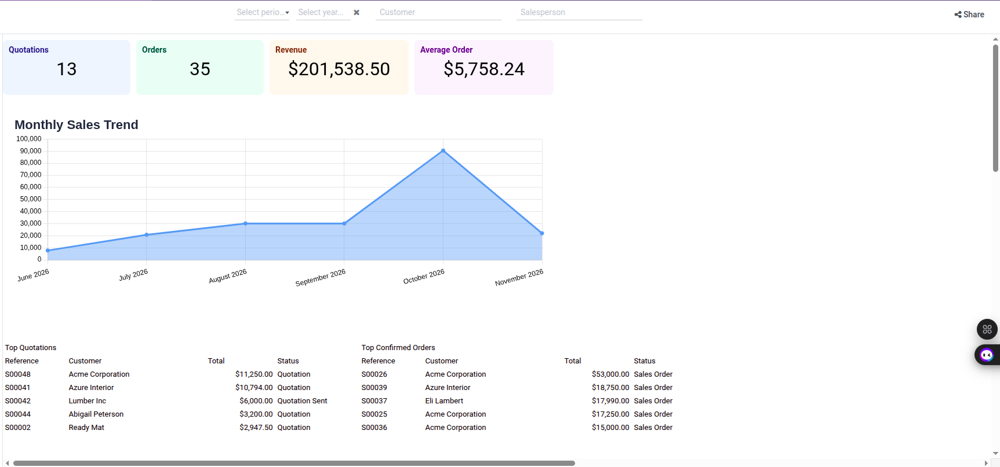
</p>

<details>
<summary><b>💬 View Example Prompt (Click to expand)</b></summary>
<br>

```text
Using my connected Odoo instance, create an Executive Sales Performance Dashboard for Q3. Show total revenue, average order value, monthly revenue trends, top 5 customers by revenue, and an order status breakdown (draft, sent, confirmed). Generate an interactive preview first so I can inspect the KPIs and charts directly before creating it in Odoo.
```
</details>

<details>
<summary><b>📋 View Live AI Output / Response (Click to expand)</b></summary>
<br>

#### Phase 1: Interactive In-Chat Preview

The preview above is built from live Odoo data for Q3 2026 (Jul 1 to Sep 30). Nothing has been created in Odoo yet.

- **Revenue:** I counted confirmed orders only, which is **$81,165.50** across 14 orders.
- **Average order value:** **$5,797.54**.
- **Monthly trend:** July $20,826, August $30,182, September $30,157.50. August and September are flat, so the July to August jump is the main story.
- **Top customers:** Gemini Furniture, Azure Interior and Eli Lambert are nearly tied at about $18k each, with Acme Corporation at $15,990. Abigail Peterson is well behind at $7,196.
- **Status breakdown:** 14 confirmed ($81,165.50), 3 draft ($5,092.50) and 1 sent ($1,740). I shown the 4 draft and sent quotes as "open pipeline" and excluded them from revenue.

*Interactive Controls:* You can toggle the trend between revenue, order count and average order, switch the status chart between order count and value, and click a customer bar for its share of Q3 revenue.

The Odoo create tool's own dry run didn't match what you asked for, so I built the preview above from my own queries instead. Its blueprint has no order status breakdown. It also lists the largest single orders rather than the top 5 customers by total revenue, and it labels the period "Last 90 Days". If you confirm, I'll use the tool's panel options to add the status breakdown and customer ranking and set a Q3 date filter.

*Reply "Confirm" or press "Create in Odoo" to deploy it.*

---

#### Phase 2: Live Deployed in Odoo (After Clicking "Create in Odoo")

The dashboard now exists in Odoo, but it isn't the full version you asked for. It contains two of your five items and misses the other three.

You can open it here: **Executive Sales Performance Dashboard - Q3 2026** (Dashboard ID 11, in the Sales group of the Dashboards app).

**What it matches:**
- **Total revenue:** $81,165.50.
- **Average order value:** $5,797.54.
- **Monthly revenue trend:** July $20,826, August $30,182 and September $30,157.50.

**What it doesn't match:**
- **Order status breakdown:** it is missing. The spreadsheet dashboard type ignored the status panel I passed in.
- **Top 5 customers:** the dashboard has a "Top Confirmed Orders" table of the largest single orders instead. It shows Acme at $15,000 and Gemini at $9,000, whereas the customer totals are $15,990 and $18,220.
- **Quotations card:** it reads 0, because the dashboard only counts confirmed orders. Your 3 draft and 1 sent quotes don't appear.
- **Date filter:** it still says "Last 90 Days" rather than Q3. The cards and chart are fixed to Jul 1 to Sep 30, so the numbers are right, but anyone changing the filter will see different data.

*Follow-up capability:* A second dashboard built as a board layout accepts custom panel definitions (monthly revenue trend, top 5 customer bar chart by total revenue, and status breakdown for draft, sent, and confirmed orders).

</details>

</details>

---

## 💼 Business Capabilities Overview

The module equips your AI with **32 comprehensive business capabilities** across all core business operations:

### 1. 📊 Executive Dashboards & Analytics
- **Live In-Chat Dashboard Previews**: Review interactive HTML reports in your chat side panel before committing them to Odoo.
- **Native Spreadsheet Dashboard Creation**: Automatically build native Odoo Spreadsheet Dashboards with live formulas and charts.
- **Executive Business KPIs**: Instantly summarize monthly sales revenue, open quotations, pending invoices, and active deliveries.
- **Aged Receivables & Payables**: 30-60-90 day aging breakdowns to keep collections on track.
- **360° Customer & Supplier Dossiers**: Lifetime revenue, order history, payment discipline, and credit overview in one command.
- **Universal Cross-Model Search**: Search across Contacts, Sales, Invoicing, CRM, and Inventory in a single request.

### 2. 🎯 Sales, CRM & Customer Relationships
- **Pipeline Stage Analysis**: Track deal counts, stage progression, and conversion velocity.
- **Opportunity Discovery & Deal Hunting**: Identify stalled deals and high-value leads needing attention.
- **Quotation Management**: Search, read, draft, and track quotations and confirmed sales orders.
- **Customer Relationship Tracing**: Explore how contacts relate to parent companies, open orders, and past deliveries.

### 3. 💰 Invoicing, Billing & Accounting
- **Invoice Status Tracking**: Filter open, paid, and overdue customer invoices and vendor bills.
- **Payment Follow-ups**: Check unpaid amounts and trigger internal collection tasks.
- **Official PDF Document Generation**: Generate base64 PDF copies of invoices, quotations, and delivery orders.

### 4. 📦 Inventory, Warehousing & Purchasing
- **Real-Time Stock Checks**: Inspect quantity on hand, incoming shipments, and outgoing customer commitments.
- **Low-Stock Early Warning**: Identify products with negative or zero forecast against confirmed sales.
- **Purchase Order Tracking**: Review supplier orders, expected arrival dates, and purchase costs.

### 5. 👥 Team Collaboration, Activities & HR
- **Chatter Discussion & Notes**: Post internal team notes or customer messages directly into Odoo record chatter.
- **Full History Review**: Read past discussions, activity logs, and status transitions on any record.
- **Task & Activity Scheduling**: Schedule calls, follow-up reminders, and meetings with assigned users and due dates.
- **Document & Attachment Reading**: Safely open and inspect text, CSV, and XML files attached to records.
- **Team Availability & Time Off**: Check team headcount and upcoming approved leaves.

### 6. 🛡️ Data Quality, Hygiene & Governance
- **Duplicate Detection**: Identify duplicate partners by Tax ID, email, or phone.
- **Missing Information Scanner**: Spot missing critical fields (emails, addresses, payment terms).
- **Security & Access Inspector**: Verify whether an action is allowed under the active user's permissions.

---

## 💻 Multi-Platform Client Configuration

Connect your favorite AI assistant in under 60 seconds with zero friction:

<details>
<summary><b>🤖 1. ChatGPT (Native Custom MCP Server)</b></summary>
<br>

Connect ChatGPT Plus / Team / Enterprise directly to your live Odoo instance in 4 simple steps:

#### **Step 1: Get Your Odoo Connection URL & Access Token**
In Odoo, navigate to **MCP Server > Access Tokens**, open your token, and click the **"Share Connection"** button. Copy the generated **Server URL** (which includes your secure session token).

<p align="center">
  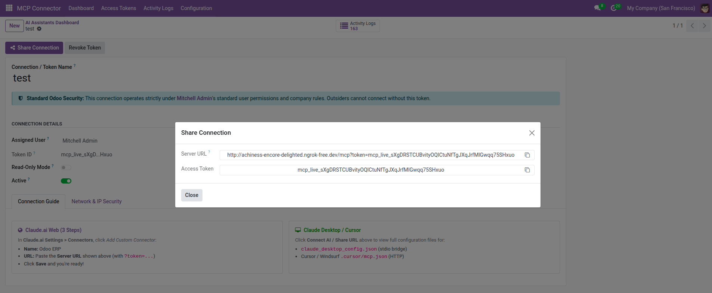
</p>

---

#### **Step 2: In ChatGPT, Open Plugins & Add Custom MCP Server**
In the left sidebar of ChatGPT, click on **Plugins**. In the upper right corner, click the **"Add"** menu and select **"Add custom MCP server"**.

<p align="center">
  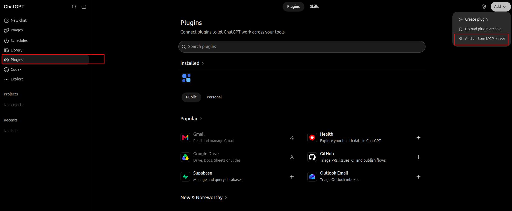
</p>

---

#### **Step 3: Configure Connection & Live URL Requirements**
In the modal:
1. Enter Name: `odoo-mcp`
2. Select **Server URL**
3. Paste your Odoo Server URL
4. Keep **Authentication** set to **No authentication** (token is already passed via URL parameter)
5. Check *"I understand and want to continue"* and click **"Create as a plugin"**

> [!CAUTION]
> ### ⚠️ CRITICAL CONNECTION REQUIREMENTS:
> - **MUST USE HTTPS (NOT HTTP):** ChatGPT cloud servers strictly require secure SSL connections and will reject plain `http://` URLs. Make sure your URL starts with **`https://`**.
> - **LIVE DOMAIN OR NGROK REQUIRED (NO `localhost`):** ChatGPT runs in OpenAI's cloud and cannot connect to your private `localhost:8069` or `127.0.0.1`.
>   - **Production Odoo:** Use your public live domain (e.g. `https://erp.yourcompany.com/mcp?token=...`).
>   - **Local Development / Testing:** Start an HTTPS tunnel like `ngrok http 8069` and use your live forwarding address (e.g. `https://xxxx.ngrok-free.dev/mcp?token=...`).

<p align="center">
  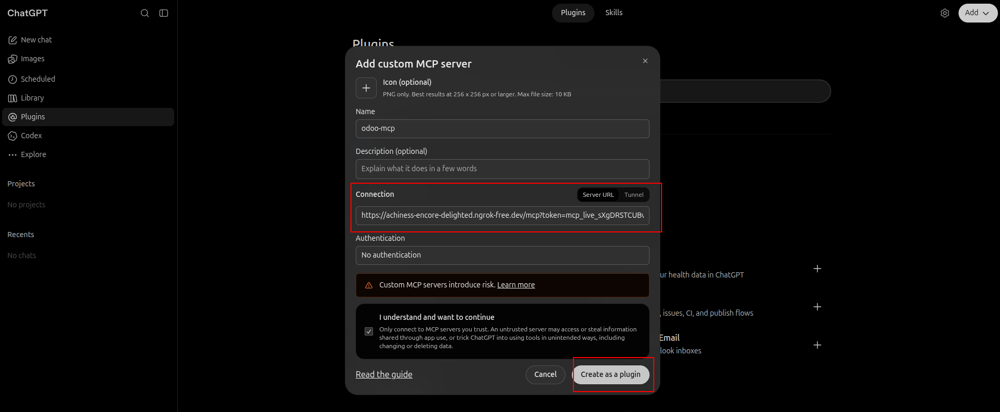
</p>

---

#### **Step 4: Mention @odoo-mcp & Chat Naturally with ERP**
In your ChatGPT prompt box, type `@od` and select **@odoo-mcp**. ChatGPT is now connected to your Odoo ERP! Ask questions, generate KPI summaries, or request live interactive dashboard previews.

<p align="center">
  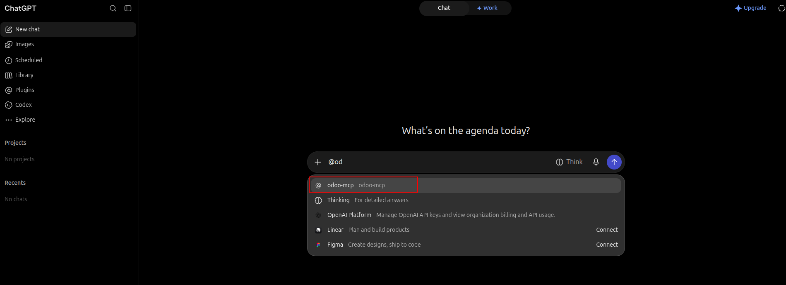
</p>

</details>

<details>
<summary><b>🟠 2. Claude (Web, Desktop App &amp; Claude Code — 3 Clicks)</b></summary>
<br>

Connect Claude (Web browser, Desktop App, or Claude Code) directly to your live Odoo instance:

#### **Step 1: Open Settings > Connectors > Add Custom Connector**
In Claude, open **Settings**. Under **Customize** in the left sidebar, click **Connectors**. Click the **"+ Add"** menu at the top right and select **"Add custom connector"**.

<p align="center">
  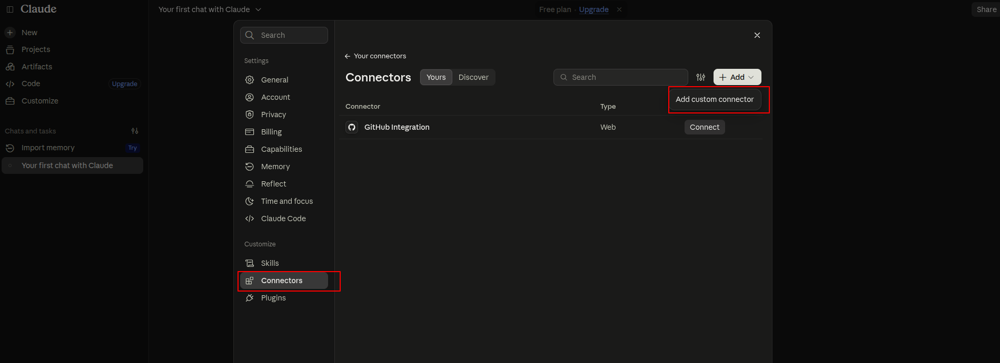 Connectors > Add custom connector" width="90%"/>
</p>

---

#### **Step 2: Configure Connector Name & Live Server URL**
In the modal:
1. Enter Name: `odoo-mcp`
2. In Server URL, paste your Odoo Server URL with your token (copied from Odoo *Access Tokens > Share Connection*)
3. Click **Continue**

> [!CAUTION]
> ### ⚠️ CRITICAL CONNECTION REQUIREMENTS:
> - **MUST USE HTTPS (NOT HTTP):** Claude strictly enforces secure connections and will reject plain `http://` URLs. Make sure your Server URL starts with **`https://`**.
> - **LIVE DOMAIN OR NGROK REQUIRED (NO `localhost`):** Claude runs in the cloud and cannot connect to your private `localhost:8069` or `127.0.0.1`.
>   - **Production Odoo:** Use your public live domain with SSL (e.g. `https://erp.yourcompany.com/mcp?token=...`).
>   - **Local Development / Testing:** Start an HTTPS tunnel like `ngrok http 8069` and use your live forwarding address (e.g. `https://xxxx.ngrok-free.dev/mcp?token=...`).

<p align="center">
  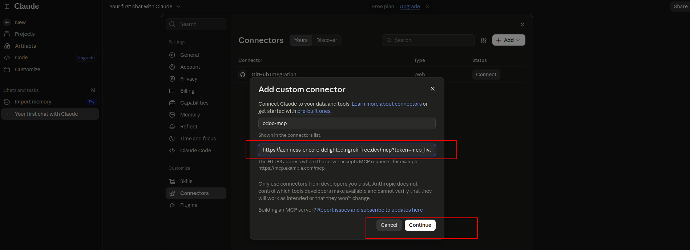
</p>

---

#### **Step 3: Enable Connector in Chat & Query Live ERP Data**
In any Claude chat session, click the **+** menu next to the chat box, select **Connectors**, and ensure **`odoo-mcp`** is toggled **ON** (blue toggle switch). Claude is now directly connected to your Odoo ERP!

<p align="center">
  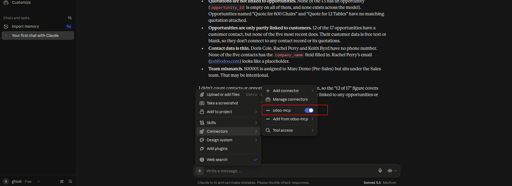
</p>

<details>
<summary>💻 Optional for Developers: Manual JSON configuration for local CLI bridge</summary>
<br>

If you prefer using the local Python stdio bridge via `claude_desktop_config.json`:
```json
{
  "mcpServers": {
    "odoo": {
      "command": "python3",
      "args": [
        "/path/to/abi_odoo_mcp/scripts/odoo_mcp_bridge.py",
        "--url", "http://localhost:8069",
        "--token", "mcp_live_YOUR_TOKEN_SECRET",
        "--db", "your_database_name"
      ]
    }
  }
}
```
</details>

</details>

<details>
<summary><b>🔵 3. Cursor IDE (.cursor/mcp.json — Direct HTTP)</b></summary>
<br>

Cursor connects directly to your Odoo MCP server over HTTP without needing any bridge script:

#### **Step 1: Open Tools & MCP in Cursor**
Press `Ctrl + Shift + P` (or `Cmd + Shift + P` on macOS), type **"mcp"**, and select **"Cursor: Tools & MCP"** (or navigate to *Settings > Tools & MCP / Customize*).

---

#### **Step 2: Add New Custom MCP Server > Select Workspace**
Under **Connected**, click **"+ New MCP Server"** (Add a Custom MCP Server). From the dropdown, select your workspace (e.g. `odoo-mcp-main`) to create or edit `.cursor/mcp.json`.

<p align="center">
  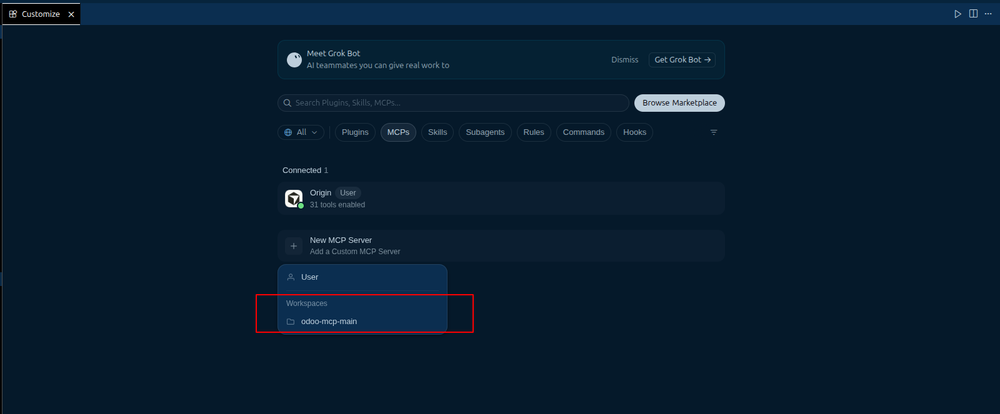
</p>

---

#### **Step 3: Paste JSON Configuration into .cursor/mcp.json**
In your `.cursor/mcp.json` file, paste the configuration snippet below. Copy your live **Server URL** directly from Odoo (via *MCP Server > Access Tokens > Share Connection*):

```json
{
  "mcpServers": {
    "odoo-mcp": {
      "url": "https://<your-odoo-domain-or-ngrok>/mcp?token=mcp_live_YOUR_TOKEN"
    }
  }
}
```

> 💡 **Tip:** The Server URL copied from Odoo automatically uses `https://` for tunnels like ngrok and live domains!

<p align="center">
  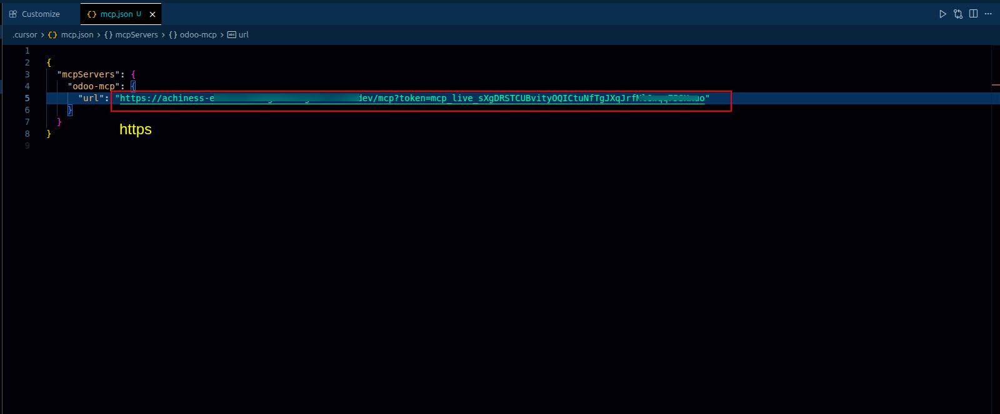
</p>

---

#### **Step 4: Enable Source & Reload**
In the **Configure odoo-mcp** popup modal, toggle the `.cursor/mcp.json` source **ON** (active) and click **Done**.

<p align="center">
  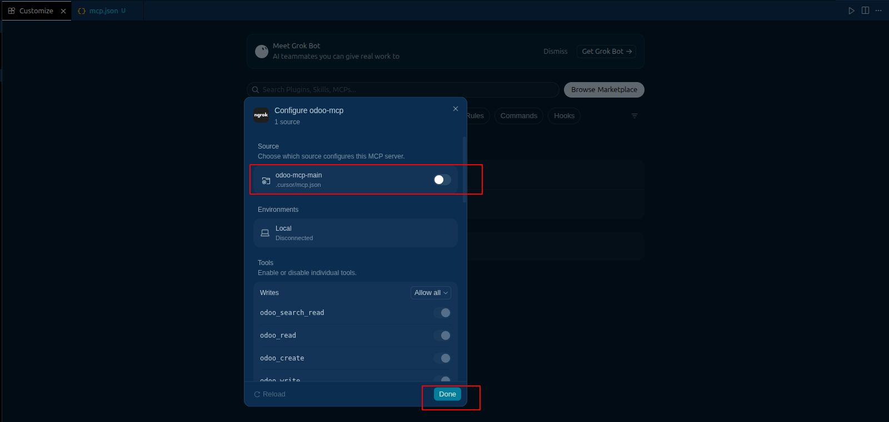
</p>

---

#### **Step 5: Verify Connection & Query Live ERP in Cursor Chat**
Notice **odoo-mcp** now displays green with **32 tools and 2 resources enabled**! In Cursor Chat (`Ctrl + L`), prompt:
> *"use my odoo-mcp, how many sale orders?"*

Cursor will immediately fetch live sales numbers directly from your Odoo database.

<p align="center">
  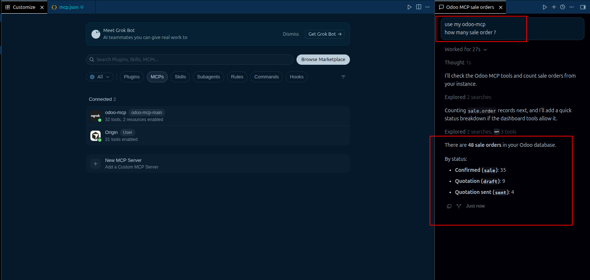
</p>

</details>

<details>
<summary><b>🪐 4. Antigravity IDE (mcp_config.json)</b></summary>
<br>

Antigravity IDE connects natively to your Odoo MCP server over HTTP via its global `mcp_config.json`.

#### **Step 1: Open Manage MCP Servers in Antigravity**
Press `Ctrl + Shift + P` (or `Cmd + Shift + P` on macOS), type **"manage mcp"**, and select **"Manage MCP servers"**.

---

#### **Step 2: Click "View raw config"**
In the Manage MCP servers view, click the **"View raw config"** button in the top right to open your global `mcp_config.json` configuration file.

<p align="center">
  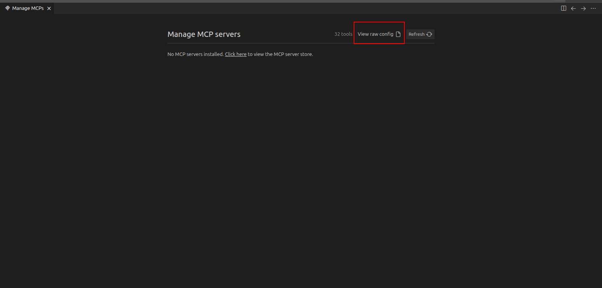
</p>

---

#### **Step 3: Paste JSON Configuration into mcp_config.json**
In `mcp_config.json`, add the `odoo-mcp` server entry under `mcpServers`. Paste your live **Server URL** copied directly from Odoo (*MCP Server > Access Tokens > Share Connection*):

```json
{
  "mcpServers": {
    "odoo-mcp": {
      "url": "https://<your-odoo-domain-or-ngrok>/mcp?token=mcp_live_YOUR_TOKEN",
      "disabled": false
    }
  }
}
```

> 💡 **Tip:** The Server URL copied from Odoo automatically uses `https://` for live domains and ngrok tunnels!

<p align="center">
  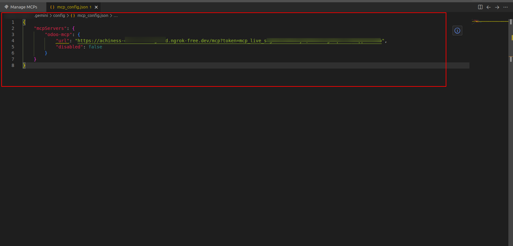
</p>

---

#### **Step 4: Click "Refresh" to Load All 32 Odoo Tools**
Save `mcp_config.json` and switch back to the Manage MCP servers panel. Click the **"Refresh"** button — Antigravity will instantly discover the server and register all **32 Odoo business tools**!

<p align="center">
  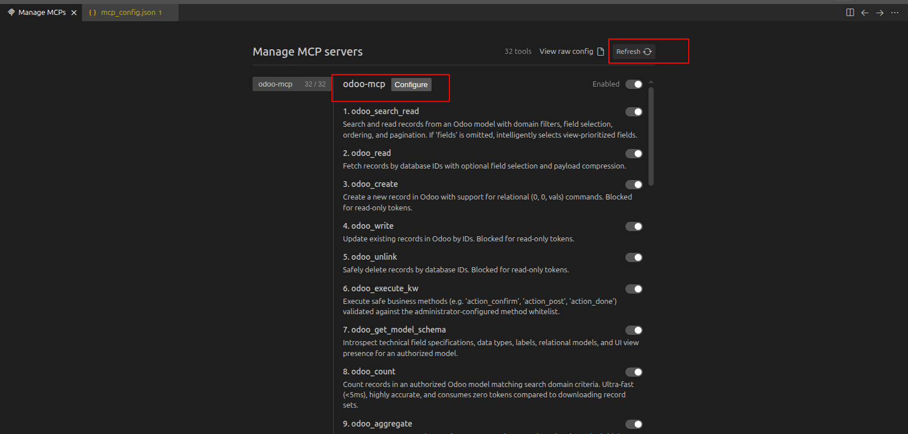
</p>

---

#### **Step 5: Verify Connection & Query Live ERP in Antigravity Chat**
In the Antigravity Chat panel, prompt:
> *"use my mcp, how many sale order i have"*

Antigravity will invoke the Odoo MCP tools in real time and return live sales figures directly from your database!

<p align="center">
  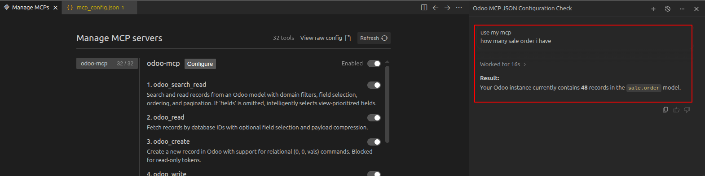
</p>

</details>

<details>
<summary><b>⚫ 5. Grok (xAI Web AI Assistant)</b></summary>
<br>

Connect Grok directly to your live Odoo instance in 4 simple steps:

#### **Step 1: In Grok, Click on Plugins > New Connector > Custom**
In the left sidebar of Grok, click on **Plugins**. In the Connectors view, click the **"New Connector"** button in the top right, then choose **"+ Custom: Add your own custom connector"**.

<p align="center">
  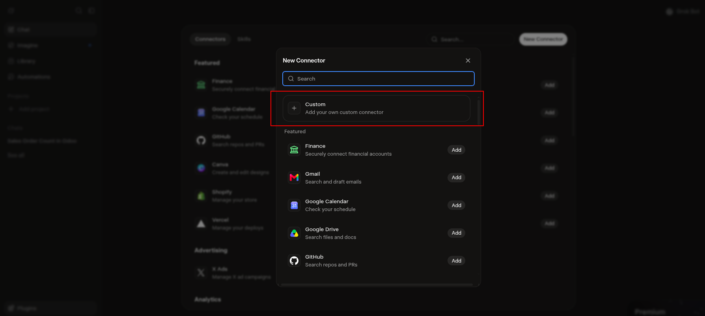
</p>

---

#### **Step 2: Enter Name & Paste HTTPS Server URL**
In the **Custom Connector** modal:
1. Enter Name: `odoo-mcp`
2. In Server URL, paste your Odoo Server URL with your token (copied from Odoo *Access Tokens > Share Connection*)
3. Click **Add Connector**

> [!CAUTION]
> ### ⚠️ CRITICAL CONNECTION REQUIREMENTS:
> - **MUST USE HTTPS (NOT HTTP):** Grok strictly enforces secure connections and will reject plain `http://` URLs. Make sure your Server URL starts with **`https://`**.
> - **LIVE DOMAIN OR NGROK REQUIRED (NO `localhost`):** Grok runs in the cloud and cannot connect to your private `localhost:8069` or `127.0.0.1`.
>   - **Production Odoo:** Use your public live domain with SSL (e.g. `https://erp.yourcompany.com/mcp?token=...`).
>   - **Local Development / Testing:** Start an HTTPS tunnel like `ngrok http 8069` and use your live forwarding address (e.g. `https://xxxx.ngrok-free.dev/mcp?token=...`).

<p align="center">
  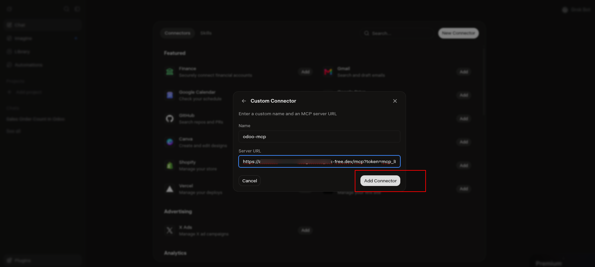
</p>

---

#### **Step 3: Enable odoo-mcp Connector in Chat Input**
In the Grok chat prompt box, click the **+** button, select **Connectors**, and toggle **odoo-mcp** to **ON** (active).

<p align="center">
  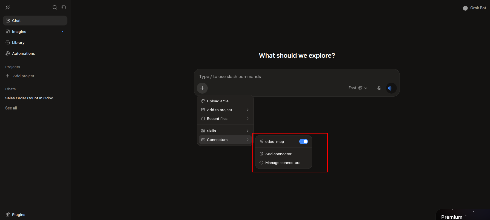
</p>

---

#### **Step 4: Verify Connection & Query Live ERP in Grok Chat**
In your Grok chat, prompt:
> *"how many sale order i have"*

Grok will invoke the Odoo MCP server in real time and return live data directly from your database!

<p align="center">
  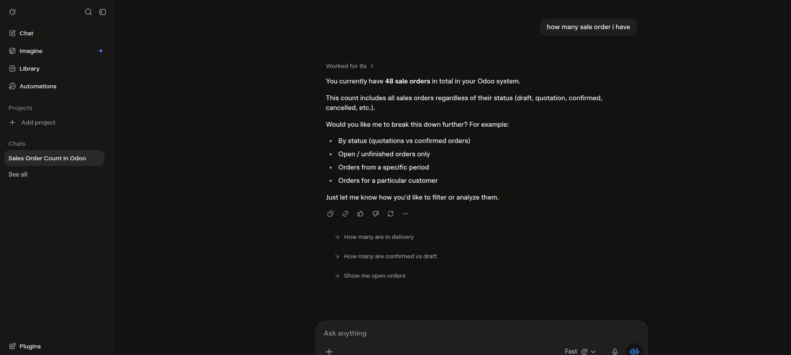
</p>

</details>

---

## 🚀 Quickstart Guide

### 1. Installation
1. Place the `abi_odoo_mcp` folder inside your Odoo addons directory.
2. In Odoo, activate **Developer Mode**, go to **Apps**, click **Update Apps List**, and search for `abi_odoo_mcp`.
3. Click **Install**.

### 2. Generate Your Connection Token
1. In Odoo, open **MCP Server** from the main App Switcher.
2. Go to **Access Tokens** and click **New**.
3. Choose a friendly name (e.g. `Claude - Sales Assistant` or `ChatGPT - Executive Briefing`) and select the **User**.
4. *(Optional)* Select a **Role Preset** (e.g., *Sales & CRM*, *Financial Auditor*, *Inventory & Logistics*, or *Full Access*).
5. Set the **Rate Limit** (e.g. `120` requests/minute, or `0` for unlimited).
6. Click **Save** and copy your generated secret key: `mcp_live_...`.

---

## 🔒 Zero-Trust Security & Peace of Mind

Your business data is protected by multiple layers of enterprise security:

1. **User-Scoped Security**: The AI operates strictly under the logged-in user's credentials. If a user cannot access Payroll or Accounting in Odoo, the AI cannot access it either.
2. **Read-Only Mode**: Need an AI that can answer questions without modifying any data? Toggle **Read-Only Mode** on the token with one click.
3. **Sliding-Window Rate Limiting**: Protects your server against runaway AI queries or excessive request loops.
4. **Bulk Action Protection**: Built-in safeguards prevent the AI from accidentally modifying or deleting more than 25 records in a single command.
5. **Sensitive Field Blacklist**: System secrets, passwords, and sensitive keys are stripped automatically before reaching the AI.
6. **Complete Audit Trail**: Every AI interaction, execution time, and response status is logged in Odoo for full transparency.

---

## ❓ FAQ — Frequently Asked Questions

### Is this module 100% free?
Yes! Odoo MCP Server is released as free, open-source software under the **LGPL-3** license.

### Do I need extra servers, Docker containers, or Python libraries?
No. The module runs **natively inside Odoo** using pure Odoo methods and standard Python libraries. No external services are required.

### Can the AI delete or mess up our company data?
No. You have complete control:
- You can turn on **Read-Only Mode** so the AI cannot create, edit, or delete anything.
- The AI only has access to what the assigned Odoo user is allowed to touch.
- Safety guards automatically block any mass updates or deletions.

### Can I preview dashboards before they appear in Odoo?
Yes! The AI generates an interactive HTML preview right inside your chat side panel (Claude/ChatGPT artifacts). You can review metrics, check rankings, and only confirm when you are satisfied.

### Does it work on both Community and Enterprise?
Yes. Odoo MCP Server is fully compatible with both Odoo Community Edition and Enterprise Edition.

---

## 📜 License

Copyright (C) 2026 Ghost Developer. Licensed under LGPL-3.

This project is licensed under the **GNU Lesser General Public License (LGPL-3)**. See the [LICENSE](LICENSE) file for details.

<p align="center">
  <sub>Built with ❤️ for the Odoo & AI Community.</sub>
</p>
